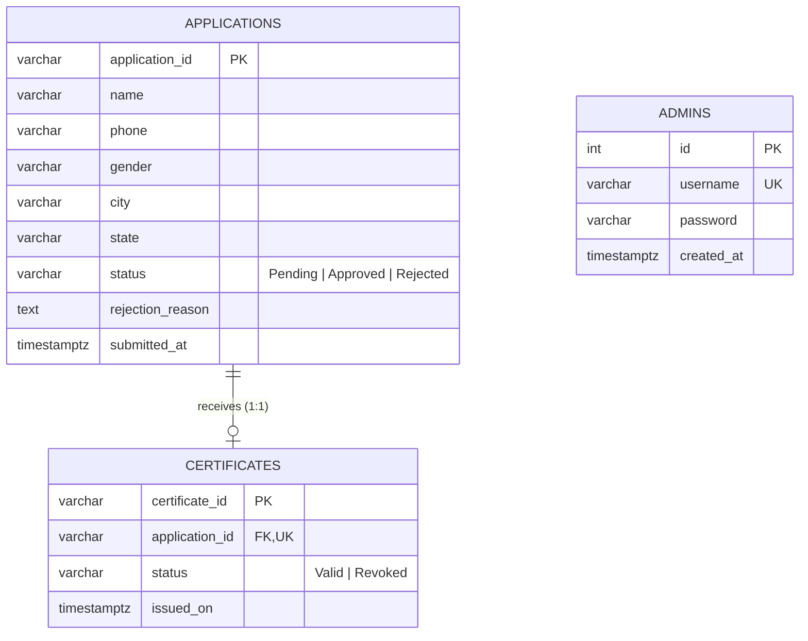

# ELEVATE-SDE-Task-4: Certificate Issuing & Verification Platform

A complete, full-stack monorepo integrating a responsive **React** frontend and a secure, transactional **Node.js / Express / PostgreSQL** backend. This platform provides citizens with self-service certificate request submission, status tracking, and public certificate verification, while giving administrators role-based tools to inspect applications, issue certificates within ACID transactions, reject invalid submissions, and revoke certificates.

---

## Table of Contents

1. [Project Overview](#1-project-overview)
2. [Folder Structure](#2-folder-structure)
3. [Technology Stack](#3-technology-stack)
4. [Prerequisites](#4-prerequisites)
5. [Installation Guide](#5-installation-guide)
6. [Environment Variables Configuration](#6-environment-variables-configuration)
7. [Database Setup & Schema](#7-database-setup--schema)
8. [Running the Application](#8-running-the-application)
9. [Default Credentials & Demo Data](#9-default-credentials--demo-data)
10. [REST API Documentation](#10-rest-api-documentation)
11. [Automated Testing & Quality Assurance](#11-automated-testing--quality-assurance)
12. [Security & Architectural Highlights](#12-security--architectural-highlights)

---

## 1. Project Overview

**ELEVATE-SDE-Task-4** consolidates the frontend user interface (from Task 2) and the backend REST API with PostgreSQL database persistence (from Task 3) into an organized workspace.

### Key Capabilities:
- **Citizen Portal**:
  - **Request Certificate**: Submit requests with citizen demographics (`fullName`, `phone`, `gender`, `city`, `state`) and automated validation.
  - **Track Application**: Query real-time status (`Pending`, `Approved`, `Rejected`) using a unique Application ID (`APP-2026-XXXXXXXX` or `APP-XXXX`).
  - **Verify Certificate**: Public, tamper-evident certificate verification showing recipient details, issue timestamp, and status (`Valid` or `Revoked`).
- **Admin Dashboard**:
  - **Authentication**: Secure login protecting administrative endpoints.
  - **Application Management**: Filter and review applications by review status.
  - **Transactional Approval & Issuance**: Approving an application automatically generates a unique Certificate ID (`CERT-2026-XXXXXXXX` or `CERT-XXXX`) within an atomic database transaction.
  - **Application Rejection**: Reject applications with optional reason feedback.
  - **Certificate Revocation**: Revoke active certificates while maintaining historical audit integrity.

---

## 2. Folder Structure

The project maintains clean separation of concerns by isolating client and server concerns into two dedicated directories:

```text
ELEVATE-SDE-Task-4/
├── README.md                           # Monorepo documentation & setup instructions
│
├── frontend/                           # React + Vite Frontend Application (Task 2)
│   ├── public/                         # Public static assets (favicon, icons)
│   ├── screenshots/                    # UI demo captures for documentation
│   ├── src/
│   │   ├── assets/                     # Component images & SVG assets
│   │   ├── components/                 # Reusable UI components (Navbar, Footer, Button, FormField, StatusBadge, etc.)
│   │   ├── data/                       # Indian states & UI dataset
│   │   ├── pages/                      # Application route pages
│   │   │   ├── Home.jsx                # Landing page with navigation to services
│   │   │   ├── RequestCertificate.jsx  # Citizen application submission form (connected to POST /api/applications)
│   │   │   ├── TrackApplication.jsx    # Application status lookup (connected to GET /api/applications/track/:id)
│   │   │   ├── VerifyCertificate.jsx   # Public certificate verification (connected to GET /api/certificates/verify/:id)
│   │   │   ├── AdminLogin.jsx          # Admin authentication page (connected to POST /api/admin/login)
│   │   │   ├── AdminApplications.jsx   # Admin application review & approval/rejection (connected to /api/admin/applications)
│   │   │   ├── AdminCertificates.jsx   # Admin certificate listing & revocation (connected to /api/admin/certificates)
│   │   │   └── NotFound.jsx            # 404 fallback page
│   │   ├── services/                   # Storage, API client, and ID generator utilities
│   │   │   ├── api.js                  # Centralized REST API client (Fetch + Bearer JWT + Error handling)
│   │   │   ├── idService.js            # Unique ID generators
│   │   │   └── storageService.js       # Client session helpers
│   │   ├── App.jsx                     # Root application component & client routes
│   │   ├── App.css                     # Global component styling
│   │   ├── index.css                   # Tailwind CSS direct imports
│   │   └── main.jsx                    # React entry point
│   ├── .gitignore                      # Frontend-specific Git exclusions
│   ├── index.html                      # HTML template
│   ├── package.json                    # Frontend dependencies & npm scripts
│   ├── tailwind.config.js              # Tailwind CSS configuration
│   ├── postcss.config.js               # PostCSS processor configuration
│   └── vite.config.js                  # Vite bundler configuration
│
└── backend/                            # Express + PostgreSQL Backend REST API (Task 3)
    ├── database/
    │   ├── schema.sql                  # PostgreSQL table definitions, constraints & indexes
    │   ├── initDb.js                   # Programmatic database table initialization script
    │   └── seedAdmin.js                # Default administrator provisioning script (bcrypt)
    ├── src/
    │   ├── config/
    │   │   └── db.js                   # PostgreSQL connection pool (node-postgres)
    │   ├── controllers/
    │   │   ├── adminController.js      # Admin authentication, approve, reject, revoke handlers
    │   │   ├── applicationController.js# Citizen submit application & status tracking handlers
    │   │   └── certificateController.js# Public certificate verification handler
    │   ├── middleware/
    │   │   ├── authMiddleware.js       # Bearer JWT verification middleware
    │   │   ├── errorMiddleware.js      # Centralized error and 404 handlers
    │   │   └── validateRequest.js      # express-validator result formatter
    │   ├── routes/
    │   │   ├── adminRoutes.js          # /api/admin/* endpoints
    │   │   ├── applicationRoutes.js    # /api/applications/* endpoints
    │   │   └── certificateRoutes.js    # /api/certificates/* endpoints
    │   ├── utils/
    │   │   └── generateIds.js          # Collision-resistant ID generator (APP / CERT)
    │   ├── app.js                      # Express application, security middleware & routing
    │   └── server.js                   # HTTP server bootstrap, DB connection & graceful shutdown
    ├── tests/
    │   ├── api.test.js                 # Automated Jest + Supertest integration tests (24 tests)
    │   └── verify_e2e_integration.js   # Live E2E integration test script (14 workflow checks)
    ├── .env                            # Active environment configuration (local)
    ├── .env.example                    # Template environment variables
    ├── .gitignore                      # Backend-specific Git exclusions
    ├── package.json                    # Backend dependencies & npm scripts
    └── postman_collection.json         # Ready-to-import Postman API test collection
```

---

## 3. Technology Stack

### Frontend:
| Technology | Role |
| :--- | :--- |
| **React 19** | Declarative component-based UI library |
| **Vite** | Fast next-generation frontend build tool and dev server |
| **React Router DOM (v7)** | Client-side routing with nested layouts and route protection |
| **Tailwind CSS (v3)** | Utility-first CSS styling framework |
| **Lucide React** | Clean, accessible iconography |

### Backend:
| Technology | Role |
| :--- | :--- |
| **Node.js (v20+)** | Server-side JavaScript runtime (ES Modules) |
| **Express.js (v4.21+)** | REST API web application framework |
| **PostgreSQL (v14+)** | Relational database management system |
| **`pg` (node-postgres)** | Connection pool client for PostgreSQL |
| **`bcryptjs`** | Salted cryptographic password hashing |
| **`jsonwebtoken` (JWT)** | Stateless Bearer token generation and validation |
| **`express-validator`** | Request validation and sanitization middleware |
| **`helmet`** | HTTP security headers protection |
| **`cors`** | Cross-Origin Resource Sharing control |
| **`dotenv`** | Environment variable management |
| **Jest & Supertest** | Automated unit and integration testing framework |

---

## 4. Prerequisites

Before installing and running the project, verify that the following tools are installed on your system:

- **Node.js**: `v20.x` or higher ([Download Node.js](https://nodejs.org/))
- **npm**: `v10.x` or higher (bundled with Node.js)
- **PostgreSQL**: `v14` or higher ([Download PostgreSQL](https://www.postgresql.org/download/))
- **Git**: For version control ([Download Git](https://git-scm.com/))
- *(Optional)* **Postman**: For testing backend REST APIs ([Download Postman](https://www.postman.com/))

Verify installed versions via terminal:
```bash
node -v
npm -v
psql --version
```

---

## 5. Installation Guide

Clone the repository or navigate to the `ELEVATE-SDE-Task-4` root directory:

```bash
cd "C:\Users\Ashwini B N\Desktop\ELEVATE-SDE-Task-4"
```

### Step 1: Install Backend Dependencies

Navigate to the `backend` folder and install packages:

```bash
cd backend
npm install
cd ..
```

### Step 2: Install Frontend Dependencies

Navigate to the `frontend` folder and install packages:

```bash
cd frontend
npm install
cd ..
```

---

## 6. Environment Variables Configuration

The backend configuration relies on an `.env` file located inside the `backend/` directory.

A template named `.env.example` is provided inside `backend/`. If `.env` does not already exist, create it:

```bash
cd backend
cp .env.example .env
# Or on Windows PowerShell:
# Copy-Item .env.example .env
```

### Variable Reference (`backend/.env`):

| Variable | Description | Default / Example Value |
| :--- | :--- | :--- |
| `PORT` | Port number on which the Express server listens | `5000` |
| `NODE_ENV` | Runtime environment (`development`, `test`, `production`) | `development` |
| `DB_HOST` | Host address of PostgreSQL server | `localhost` |
| `DB_PORT` | PostgreSQL listening port | `5432` |
| `DB_USER` | PostgreSQL user account | `postgres` |
| `DB_PASSWORD` | PostgreSQL password for the above user | `your_postgres_password` |
| `DB_NAME` | Primary application database name | `certificate_platform` |
| `DB_NAME_TEST` | Isolated database name for automated test suite | `certificate_platform_test` |
| `JWT_SECRET` | Secret key used to sign and verify JSON Web Tokens | `your_super_secret_jwt_key` |
| `JWT_EXPIRES_IN`| Lifetime of the generated admin JWT token | `24h` |
| `CORS_ORIGIN` | Allowed origin for frontend client requests | `http://localhost:5173` |
| `ADMIN_DEFAULT_USERNAME` | Default admin username created by seed script | `admin` |
| `ADMIN_DEFAULT_PASSWORD` | Default admin password created by seed script | `AdminPass@123` |

> [!IMPORTANT]
> Keep `.env` out of version control. The `.gitignore` files are pre-configured to exclude `.env` files to safeguard your credentials.

---

## 7. Database Setup & Schema

### Step 1: Create PostgreSQL Databases

Ensure your PostgreSQL service is running. Create both the development and test databases using `psql` or pgAdmin:

```sql
CREATE DATABASE certificate_platform;
CREATE DATABASE certificate_platform_test;
```

*Using PowerShell CLI:*
```powershell
$env:PGPASSWORD = "your_postgres_password"
& "C:\Program Files\PostgreSQL\18\bin\psql.exe" -U postgres -h localhost -c "CREATE DATABASE certificate_platform;"
& "C:\Program Files\PostgreSQL\18\bin\psql.exe" -U postgres -h localhost -c "CREATE DATABASE certificate_platform_test;"
```

### Step 2: Initialize Database Schema

Run the database schema initialization script from the `backend` folder:

```bash
cd backend
npm run db:init
```

This creates the required tables and indexes defined in `backend/database/schema.sql`.

### Step 3: Seed Default Administrator

Provision the default admin account:

```bash
npm run seed:admin
```

This generates an admin record with a securely hashed bcrypt password.

### Database Schema Structure:



- **`applications`**: Stores citizen demographic details (`application_id`, `name`, `phone`, `gender`, `city`, `state`, `status`, `rejection_reason`, `submitted_at`).
- **`certificates`**: Stores issued certificates (`certificate_id`, `application_id`, `status`, `issued_on`). Includes a `UNIQUE` foreign key constraint ensuring an application can never have more than one certificate.
- **`admins`**: Stores administrative credentials with bcrypt hashes (`id`, `username`, `password`, `created_at`).

---

## 8. Running the Application

To run the complete application, open **two separate terminal windows** (one for backend, one for frontend).

### Terminal 1: Run Backend Server

```bash
cd backend
npm run dev
```

*The backend server will start at:*
- **Base Server**: `http://localhost:5000`
- **API Endpoint**: `http://localhost:5000/api`
- **Health Check**: `http://localhost:5000/api/health`

*(Use `npm start` to run in standard production mode without hot-reloading).*

### Terminal 2: Run Frontend Client

```bash
cd frontend
npm run dev
```

*The Vite development server will start at:*
- **Web App**: `http://localhost:5173`

Open `http://localhost:5173` in your browser to interact with the platform.

---

## 9. Default Credentials & Demo Data

### Backend Admin Credentials (API / Database):
- **Username**: `admin`
- **Password**: `AdminPass@123`
*(Stored as a bcrypt hash with 10 salt rounds)*

### Frontend Demo Admin Credentials (Client Prototype):
- **Username**: `admin`
- **Password**: `admin`

### Sample IDs for Testing:
| Type | Format / Sample ID |
| :--- | :--- |
| **Application ID** | `APP-2026-XXXXXXXX` (Backend) or `APP-0001` (Frontend Demo) |
| **Certificate ID** | `CERT-2026-XXXXXXXX` (Backend) or `CERT-0001` (Frontend Demo) |

---

## 10. REST API Documentation

Base URL: `http://localhost:5000/api`

| # | Endpoint | Method | Access | Description |
| :---: | :--- | :---: | :---: | :--- |
| **1** | `/applications` | `POST` | Public | Submit a new citizen certificate application |
| **2** | `/applications/track/:applicationId` | `GET` | Public | Track the review status of an application |
| **3** | `/certificates/verify/:certificateId` | `GET` | Public | Verify certificate authenticity and status via SQL JOIN |
| **4** | `/admin/login` | `POST` | Public | Authenticate admin and receive a signed JWT token |
| **5** | `/admin/applications` | `GET` | Protected | List all applications (supports `?status=Pending\|Approved\|Rejected`) |
| **6** | `/admin/applications/:applicationId/approve` | `PATCH` | Protected | Approve application & issue certificate (ACID transaction) |
| **7** | `/admin/applications/:applicationId/reject` | `PATCH` | Protected | Reject application with optional reason body |
| **8** | `/admin/certificates` | `GET` | Protected | List all issued certificates (supports `?status=Valid\|Revoked`) |
| **9** | `/admin/certificates/:certificateId/revoke` | `PATCH` | Protected | Revoke an active certificate |
| **10**| `/health` | `GET` | Public | Server health and uptime status check |

### Postman Testing:
A complete, pre-configured collection is provided at `backend/postman_collection.json`. Import this file into Postman to test all endpoints with automated token capture.

---

## 11. Automated Testing & Quality Assurance

The backend includes a comprehensive automated test suite built with **Jest** and **Supertest** covering 24 distinct integration scenarios against the isolated test database `certificate_platform_test`.

### Run the Backend Tests:

```bash
cd backend
npm test
```

### Verified Test Cases:
- Health check verification (`/api/health`)
- Citizen application validation rules (missing fields, invalid phone formats)
- Application status tracking (positive and 404 negative cases)
- Admin authentication (valid credentials, invalid passwords, token generation)
- Protected route authorization checks (missing or malformed Bearer tokens)
- Application listing with query filter validation
- ACID transactional approval and unique certificate generation
- Conflict prevention (attempting to re-approve or re-reject processed applications)
- Application rejection with optional reason logging
- Public certificate verification with citizen JOIN data
- Certificate revocation and validation of updated status

---

## 12. Security & Architectural Highlights

1. **ACID Transactional Issuance**: Approving an application and generating a certificate run inside a single PostgreSQL transaction (`BEGIN` ... `COMMIT`). If any step fails, changes are completely rolled back (`ROLLBACK`), preventing inconsistent states.
2. **Duplicate Prevention**: The `certificates` table enforces a `UNIQUE` constraint on `application_id`, ensuring no application can receive more than one certificate.
3. **Stateless JWT Security**: Protected administrative endpoints verify signed JSON Web Tokens passed via the `Authorization: Bearer <token>` header.
4. **Bcrypt Password Encryption**: Administrative passwords are protected with 10 salt rounds of one-way bcrypt hashing.
5. **SQL Injection Prevention**: All database queries are executed using parameterized prepared statements (`$1, $2, ...`).
6. **Defensive HTTP Headers**: Powered by `helmet` to protect against cross-site scripting (XSS), MIME-type sniffing, and clickjacking.
7. **Clean Monorepo Boundaries**: The frontend and backend run independently, allowing either layer to be deployed, scaled, or developed without tight coupling.

---

## License & Attribution

Developed as part of the **ELEVATE SDE Internship Program**.
- **Task 2**: Frontend Certificate Issuing & Verification Platform (`frontend/`)
- **Task 3**: Backend REST API & PostgreSQL Database (`backend/`)
- **Task 4**: Full-Stack Architecture Integration (`ELEVATE-SDE-Task-4/`)
