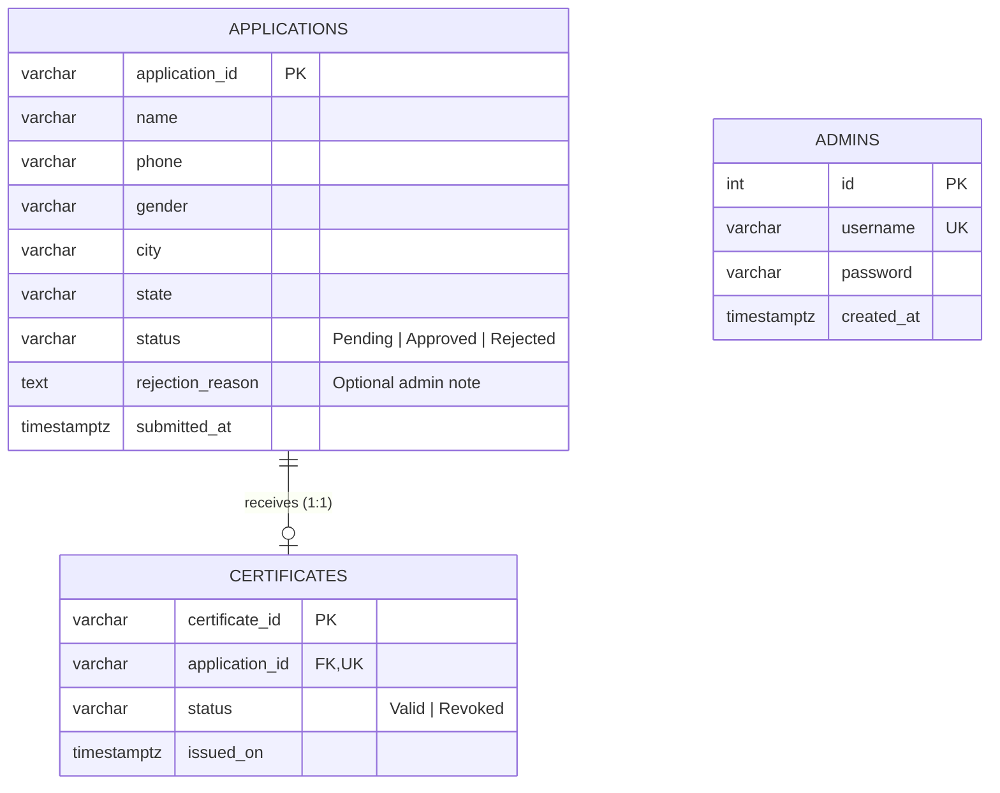

# Certificate Issuing & Verification Platform (Backend)
### ELEVATE SDE Internship – Task 3

A robust, secure, and production-grade REST API backend built with **Node.js**, **Express.js**, and **PostgreSQL**. This platform enables citizens to request official certificates, track application statuses, and verify certificates publicly, while empowering system administrators to securely review applications, issue tamper-evident certificates within database transactions, and revoke certificates when necessary.

---

## Table of Contents
1. [Project Overview & Features](#1-project-overview--features)
2. [Technology Stack](#2-technology-stack)
3. [System Architecture & Folder Structure](#3-system-architecture--folder-structure)
4. [PostgreSQL Database Design & Schema](#4-postgresql-database-design--schema)
5. [Prerequisites & System Setup](#5-prerequisites--system-setup)
6. [Installation & Dependency Setup](#6-installation--dependency-setup)
7. [Environment Configuration (.env)](#7-environment-configuration-env)
8. [Database Initialization & Admin Seeding](#8-database-initialization--admin-seeding)
9. [Running the Backend](#9-running-the-backend)
10. [REST API Documentation (All 9 Endpoints)](#10-rest-api-documentation-all-9-endpoints)
11. [Testing with Postman](#11-testing-with-postman)
12. [Automated Testing (Jest & Supertest)](#12-automated-testing-jest--supertest)
13. [Frontend Integration (Connecting with Task 2)](#13-frontend-integration-connecting-with-task-2)
14. [Security & Production Readiness](#14-security--production-readiness)
15. [Troubleshooting & Common Errors](#15-troubleshooting--common-errors)
16. [GitHub Submission Instructions](#16-github-submission-instructions)

---

## 1. Project Overview & Features

### Core Capabilities:
- **Citizen Application Submission**: Citizens can submit applications for certificates by providing their verified demographic information (`name`, `phone`, `gender`, `city`, `state`).
- **Real-time Application Tracking**: Transparent status tracking (`Pending`, `Approved`, `Rejected`) using a collision-resistant, human-readable ID (`APP-2026-XXXXXXXX`).
- **Public Certificate Verification**: High-integrity public verification via SQL JOIN, returning certificate status (`Valid` or `Revoked`) without exposing confidential admin details or excessive personal data.
- **Admin Authentication**: JWT-based session authorization with passwords hashed using `bcryptjs` (salt rounds: 10). No plaintext passwords are ever stored.
- **Transactional Approval & Issuance**: Approving an application automatically generates a unique Certificate ID (`CERT-2026-XXXXXXXX`) and inserts the certificate inside an atomic **PostgreSQL ACID transaction** (`BEGIN` ... `COMMIT`).
- **Duplicate Prevention**: Database-level unique constraints strictly prohibit issuing multiple certificates for a single application.
- **Certificate Revocation**: Dedicated revocation endpoint updates certificate status to `Revoked` while preserving the application's underlying historical approval status.
- **Input Validation & Sanitization**: Strict input validation using `express-validator` to guarantee clean data inputs and prevent injection or malformed requests.
- **Robust Security**: Protected with `helmet` security headers, CORS origin controls, parameterized SQL queries, and error masking.

---

## 2. Technology Stack

| Technology | Purpose |
| :--- | :--- |
| **Node.js (v20+)** | Server-side JavaScript runtime environment (ES Modules enabled) |
| **Express.js (v4.21+)** | Minimalist web application framework for routing and middleware |
| **PostgreSQL (v14+)** | High-performance relational database for persistent, relational storage |
| **pg (`node-postgres`)** | Enterprise-grade PostgreSQL client connection pool |
| **bcryptjs** | One-way cryptographic password hashing |
| **jsonwebtoken (JWT)** | Stateless authentication token generation and verification |
| **express-validator** | Declarative schema validation and request sanitization |
| **helmet** | Security headers protection (XSS, Clickjacking, MIME-sniffing) |
| **cors** | Configurable Cross-Origin Resource Sharing for frontend client access |
| **dotenv** | Environment-based configuration management |
| **Jest & Supertest** | Automated unit and integration testing suite |

---

## 3. System Architecture & Folder Structure

```
ELEVATE-SDE-Task-3/
├── database/
│   ├── schema.sql              # Complete PostgreSQL schema definitions and indexes
│   ├── initDb.js               # Programmatic database initialization script
│   └── seedAdmin.js            # Secure admin account provisioning script (bcrypt)
├── src/
│   ├── config/
│   │   └── db.js               # PostgreSQL connection pool configuration
│   ├── controllers/
│   │   ├── adminController.js         # Admin authentication, approvals, rejections, revocation
│   │   ├── applicationController.js   # Citizen application submission & status tracking
│   │   └── certificateController.js   # Public certificate verification
│   ├── middleware/
│   │   ├── authMiddleware.js   # Bearer JWT token authentication
│   │   ├── errorMiddleware.js  # Centralized error handler and 404 handler
│   │   └── validateRequest.js  # express-validator result formatter
│   ├── routes/
│   │   ├── adminRoutes.js             # /api/admin/* endpoints
│   │   ├── applicationRoutes.js       # /api/applications/* endpoints
│   │   └── certificateRoutes.js       # /api/certificates/* endpoints
│   ├── utils/
│   │   └── generateIds.js      # APP-YYYY-XXXXXXXX and CERT-YYYY-XXXXXXXX generators
│   ├── app.js                  # Express application setup, security middleware, and routes
│   └── server.js               # Server bootstrap, DB health verification, and listener
├── tests/
│   └── api.test.js             # Comprehensive Jest + Supertest integration tests (24 tests)
├── .env.example                # Environment variable template
├── .gitignore                  # Git ignore rules (node_modules, .env, logs)
├── package.json                # Project dependencies, scripts, and configuration
├── postman_collection.json     # Pre-configured Postman collection ready for import
└── README.md                   # Comprehensive project documentation
```

---

## 4. PostgreSQL Database Design & Schema

The platform relies on three normalized relational tables enforcing referential integrity, unique constraints, and check constraints:



### Table Definitions:

#### 1. `applications` Table
- `application_id`: `VARCHAR(30)` PRIMARY KEY (Format: `APP-2026-XXXXXXXX`)
- `name`: `VARCHAR(100)` NOT NULL
- `phone`: `VARCHAR(20)` NOT NULL
- `gender`: `VARCHAR(20)` NOT NULL
- `city`: `VARCHAR(100)` NOT NULL
- `state`: `VARCHAR(100)` NOT NULL
- `status`: `VARCHAR(20)` NOT NULL DEFAULT `'Pending'` CHECK (`status IN ('Pending', 'Approved', 'Rejected')`)
- `rejection_reason`: `TEXT` DEFAULT NULL *(Documented extension: stores optional feedback when an application is rejected)*
- `submitted_at`: `TIMESTAMPTZ` NOT NULL DEFAULT `CURRENT_TIMESTAMP`

#### 2. `certificates` Table
- `certificate_id`: `VARCHAR(30)` PRIMARY KEY (Format: `CERT-2026-XXXXXXXX`)
- `application_id`: `VARCHAR(30)` NOT NULL UNIQUE REFERENCES `applications(application_id)` ON DELETE CASCADE
  *(The `UNIQUE` constraint strictly prohibits issuing duplicate certificates for the same application).*
- `issued_on`: `TIMESTAMPTZ` NOT NULL DEFAULT `CURRENT_TIMESTAMP`
- `status`: `VARCHAR(20)` NOT NULL DEFAULT `'Valid'` CHECK (`status IN ('Valid', 'Revoked')`)

#### 3. `admins` Table
- `id`: `SERIAL` PRIMARY KEY
- `username`: `VARCHAR(50)` NOT NULL UNIQUE
- `password`: `VARCHAR(255)` NOT NULL *(Stores one-way bcrypt hash)*
- `created_at`: `TIMESTAMPTZ` NOT NULL DEFAULT `CURRENT_TIMESTAMP`

---

## 5. Prerequisites & System Setup

Ensure you have the following installed on your machine:
- **Node.js**: Version 20.x or later ([Download Node.js](https://nodejs.org/))
- **PostgreSQL**: Version 14 or later ([Download PostgreSQL](https://www.postgresql.org/download/))
- **Git**: For version control ([Download Git](https://git-scm.com/))
- **Postman**: For API verification ([Download Postman](https://www.postman.com/))

Verify installations in Windows PowerShell:
```powershell
node -v
npm -v
psql --version
```

---

## 6. Installation & Dependency Setup

1. Open **Windows PowerShell** and navigate to the project directory:
   ```powershell
   cd "C:\Users\Ashwini B N\Desktop\ELEVATE-SDE-Task-3"
   ```

2. Install all required dependencies:
   ```powershell
   npm install
   ```

---

## 7. Environment Configuration (.env)

A template `.env.example` is provided in the repository root. Create your active `.env` file:

```powershell
Copy-Item .env.example .env
```

Open `.env` and verify the settings for your local PostgreSQL instance:

```env
# Server Configuration
PORT=5000
NODE_ENV=development

# PostgreSQL Database Configuration
DB_HOST=localhost
DB_PORT=5432
DB_USER=postgres
DB_PASSWORD=A1B2C3
DB_NAME=certificate_platform
DB_NAME_TEST=certificate_platform_test

# JWT Authentication
JWT_SECRET=supersecretjwtkey_elevate_task3_2026_dev
JWT_EXPIRES_IN=24h

# CORS Configuration (Allows requests from Task 2 Vite frontend)
CORS_ORIGIN=http://localhost:5173

# Default Admin Credentials for Seed Script
ADMIN_DEFAULT_USERNAME=admin
ADMIN_DEFAULT_PASSWORD=AdminPass@123
```

> [!IMPORTANT]
> Never commit your `.env` file to GitHub. The `.gitignore` file is already configured to exclude `.env` to prevent credential leaks.

---

## 8. Database Initialization & Admin Seeding

### Step 1: Create the PostgreSQL Databases
If not already created, run the following in PowerShell using the PostgreSQL CLI (`psql`):

```powershell
$env:PGPASSWORD = "your_postgres_password"
& "C:\Program Files\PostgreSQL\18\bin\psql.exe" -U postgres -h localhost -c "CREATE DATABASE certificate_platform;"
& "C:\Program Files\PostgreSQL\18\bin\psql.exe" -U postgres -h localhost -c "CREATE DATABASE certificate_platform_test;"
```

### Step 2: Initialize Tables & Indexes
Run the automated initialization script to execute `database/schema.sql`:

```powershell
npm run db:init
```

*Output:*
```
🔄 Applying database schema...
✅ Database schema initialized successfully!
```

### Step 3: Seed the First Admin Account
Create the initial administrator account with a bcrypt-hashed password:

```powershell
npm run seed:admin
```

*Output:*
```
✅ Default admin created successfully!
   Username: admin
   (Password securely hashed with bcrypt)
```

Default credentials provisioned:
- **Username**: `admin`
- **Password**: `AdminPass@123`

---

## 9. Running the Backend

### Development Mode (with hot-reloading via Nodemon):
```powershell
npm run dev
```

### Production / Standard Mode:
```powershell
npm start
```

When started, you will see:
```
⏳ Connecting to PostgreSQL database...
✅ PostgreSQL connection established successfully.
🔄 Applying database schema...
✅ Database schema initialized successfully!
ℹ️  Admin account 'admin' already exists.
🚀 Server is listening at http://localhost:5000
📌 Base API Endpoint: http://localhost:5000/api
🛡️  Health check: http://localhost:5000/api/health
```

---

## 10. REST API Documentation (All 9 Endpoints)

**Base URL**: `http://localhost:5000/api`

---

### API 1: Request Certificate
Submits a citizen application for certificate issuance.

- **Method**: `POST`
- **URL**: `/applications`
- **Access**: Public
- **Headers**: `Content-Type: application/json`
- **Request Body**:
  ```json
  {
    "name": "Example Citizen",
    "phone": "9876543210",
    "gender": "Female",
    "city": "Bengaluru",
    "state": "Karnataka"
  }
  ```
- **Success Response (`201 Created`)**:
  ```json
  {
    "success": true,
    "message": "Certificate application submitted successfully",
    "applicationId": "APP-2026-F4B3C2A1",
    "status": "Pending"
  }
  ```
- **Error Response (`400 Bad Request`)**:
  ```json
  {
    "success": false,
    "message": "Validation failed",
    "errors": [
      {
        "field": "phone",
        "message": "Phone number must be a valid number of 7 to 20 digits."
      }
    ]
  }
  ```

---

### API 2: Track Application
Allows citizens to look up the real-time status of their certificate request.

- **Method**: `GET`
- **URL**: `/applications/track/:applicationId`
- **Access**: Public
- **Example URL**: `/api/applications/track/APP-2026-F4B3C2A1`
- **Success Response (`200 OK`)**:
  ```json
  {
    "success": true,
    "applicationId": "APP-2026-F4B3C2A1",
    "name": "Example Citizen",
    "status": "Pending",
    "submittedAt": "2026-10-26T13:10:00.000Z"
  }
  ```
- **Error Response (`404 Not Found`)**:
  ```json
  {
    "success": false,
    "message": "Application not found"
  }
  ```

---

### API 3: Verify Certificate
Public verification of an issued certificate using a SQL JOIN with the application records.

- **Method**: `GET`
- **URL**: `/certificates/verify/:certificateId`
- **Access**: Public
- **Example URL**: `/api/certificates/verify/CERT-2026-9E8D7C6B`
- **Success Response (`200 OK`)**:
  ```json
  {
    "success": true,
    "certificateId": "CERT-2026-9E8D7C6B",
    "name": "Example Citizen",
    "phone": "9876543210",
    "issuedOn": "2026-10-26T13:12:45.000Z",
    "status": "Valid"
  }
  ```
- **Revoked Certificate Response (`200 OK`)**:
  *(Revoked certificates are still verifiable, but clearly state their revoked status)*
  ```json
  {
    "success": true,
    "certificateId": "CERT-2026-9E8D7C6B",
    "name": "Example Citizen",
    "phone": "9876543210",
    "issuedOn": "2026-10-26T13:12:45.000Z",
    "status": "Revoked"
  }
  ```
- **Error Response (`404 Not Found`)**:
  ```json
  {
    "success": false,
    "message": "Certificate not found"
  }
  ```

---

### API 4: Admin Login
Authenticates an administrator and returns a signed JWT token.

- **Method**: `POST`
- **URL**: `/admin/login`
- **Access**: Public
- **Headers**: `Content-Type: application/json`
- **Request Body**:
  ```json
  {
    "username": "admin",
    "password": "AdminPass@123"
  }
  ```
- **Success Response (`200 OK`)**:
  ```json
  {
    "success": true,
    "message": "Login successful",
    "token": "eyJhbGciOiJIUzI1NiIsInR5cCI6IkpXVCJ9...",
    "admin": {
      "id": 1,
      "username": "admin"
    }
  }
  ```
- **Error Response (`401 Unauthorized`)**:
  ```json
  {
    "success": false,
    "message": "Invalid username or password"
  }
  ```

---

### API 5: Admin List Applications
Retrieves all citizen applications with optional status filtering.

- **Method**: `GET`
- **URL**: `/admin/applications`
- **Query Parameter (Optional)**: `?status=Pending` (or `Approved`, `Rejected`)
- **Access**: Protected (Requires Admin JWT)
- **Headers**: `Authorization: Bearer <your_jwt_token>`
- **Success Response (`200 OK`)**:
  ```json
  {
    "success": true,
    "count": 1,
    "applications": [
      {
        "applicationId": "APP-2026-F4B3C2A1",
        "name": "Example Citizen",
        "phone": "9876543210",
        "gender": "Female",
        "city": "Bengaluru",
        "state": "Karnataka",
        "status": "Pending",
        "rejectionReason": null,
        "submittedAt": "2026-10-26T13:10:00.000Z"
      }
    ]
  }
  ```

---

### API 6: Approve Application
Approves a pending application and issues a certificate inside a PostgreSQL ACID transaction.

- **Method**: `PATCH`
- **URL**: `/admin/applications/:applicationId/approve`
- **Access**: Protected (Requires Admin JWT)
- **Headers**: `Authorization: Bearer <your_jwt_token>`
- **Success Response (`200 OK`)**:
  ```json
  {
    "success": true,
    "message": "Application approved and certificate issued successfully",
    "applicationId": "APP-2026-F4B3C2A1",
    "status": "Approved",
    "certificateId": "CERT-2026-9E8D7C6B"
  }
  ```
- **Error Response (`409 Conflict` - Already Processed)**:
  ```json
  {
    "success": false,
    "message": "Application cannot be approved because it has already been processed (current status: Approved)"
  }
  ```
- **Error Response (`404 Not Found`)**:
  ```json
  {
    "success": false,
    "message": "Application not found"
  }
  ```

---

### API 7: Reject Application
Rejects a pending application with an optional explanation.

- **Method**: `PATCH`
- **URL**: `/admin/applications/:applicationId/reject`
- **Access**: Protected (Requires Admin JWT)
- **Headers**:
  - `Authorization: Bearer <your_jwt_token>`
  - `Content-Type: application/json`
- **Request Body (Optional)**:
  ```json
  {
    "reason": "Address verification proof was blurry or expired."
  }
  ```
- **Success Response (`200 OK`)**:
  ```json
  {
    "success": true,
    "message": "Application rejected successfully",
    "applicationId": "APP-2026-F4B3C2A1",
    "status": "Rejected"
  }
  ```
- **Error Response (`409 Conflict`)**:
  ```json
  {
    "success": false,
    "message": "Application cannot be rejected because it has already been processed (current status: Rejected)"
  }
  ```

---

### API 8: Admin List Certificates
Lists all issued certificates joined with citizen information.

- **Method**: `GET`
- **URL**: `/admin/certificates`
- **Query Parameter (Optional)**: `?status=Valid` (or `Revoked`)
- **Access**: Protected (Requires Admin JWT)
- **Headers**: `Authorization: Bearer <your_jwt_token>`
- **Success Response (`200 OK`)**:
  ```json
  {
    "success": true,
    "count": 1,
    "certificates": [
      {
        "certificateId": "CERT-2026-9E8D7C6B",
        "applicationId": "APP-2026-F4B3C2A1",
        "name": "Example Citizen",
        "phone": "9876543210",
        "issuedOn": "2026-10-26T13:12:45.000Z",
        "status": "Valid"
      }
    ]
  }
  ```

---

### API 9: Revoke Certificate
Revokes an active certificate. Modifies **only** the certificate's status without changing the application's historical record.

- **Method**: `PATCH`
- **URL**: `/admin/certificates/:certificateId/revoke`
- **Access**: Protected (Requires Admin JWT)
- **Headers**: `Authorization: Bearer <your_jwt_token>`
- **Success Response (`200 OK`)**:
  ```json
  {
    "success": true,
    "message": "Certificate revoked successfully",
    "certificateId": "CERT-2026-9E8D7C6B",
    "status": "Revoked"
  }
  ```
- **Error Response (`409 Conflict` - Already Revoked)**:
  ```json
  {
    "success": false,
    "message": "Certificate is already revoked"
  }
  ```
- **Error Response (`404 Not Found`)**:
  ```json
  {
    "success": false,
    "message": "Certificate not found"
  }
  ```

---

## 11. Testing with Postman

A complete Postman collection is included directly in the repository root as `postman_collection.json`.

### How to Import and Test:
1. Open **Postman**.
2. Click **Import** (top left) and select the file `postman_collection.json` located inside `ELEVATE-SDE-Task-3/`.
3. In the collection, the variable `baseUrl` is set to `http://localhost:5000/api`.
4. Run the requests in sequence:
   - **Step 1**: Send `0. Health Check` (verify API is reachable).
   - **Step 2**: Send `1. Citizen - Request Certificate` (note the returned `applicationId`).
   - **Step 3**: Send `2. Citizen - Track Application` (paste the `applicationId`).
   - **Step 4**: Send `4. Admin - Login` with username `admin` and password `AdminPass@123`.
     *(A post-response test script will automatically capture the JWT token and set the `adminToken` variable for all subsequent requests!)*
   - **Step 5**: Send `5. Admin - List Applications`.
   - **Step 6**: Send `6. Admin - Approve Application` (pass the `applicationId`).
   - **Step 7**: Send `8. Admin - List Certificates` (view newly issued certificate).
   - **Step 8**: Send `3. Public - Verify Certificate` (verify validity).
   - **Step 9**: Send `9. Admin - Revoke Certificate` (revoke the certificate).
   - **Step 10**: Re-run `3. Public - Verify Certificate` to confirm status is now `Revoked`.

---

## 12. Automated Testing (Jest & Supertest)

This project features an automated end-to-end integration test suite using **Jest** and **Supertest** covering 24 distinct scenarios against an isolated PostgreSQL test database (`certificate_platform_test`).

### Run the Test Suite:
```powershell
npm test
```

### Verified Test Scenarios:
- [x] **Health Check**: Confirms `/api/health` returns status 200.
- [x] **Validation**: Missing or invalid application fields return HTTP 400 with descriptive error messages.
- [x] **Submission**: Successful application submission generates `APP-2026-XXXXXXXX` format and status `Pending`.
- [x] **Tracking**: Tracking an existing application returns correct status without leaking sensitive details.
- [x] **Tracking 404**: Tracking a non-existent ID returns HTTP 404.
- [x] **Admin Authentication**: Invalid credentials return HTTP 401; valid credentials return signed JWT without exposing password hashes.
- [x] **Access Control**: Admin endpoints reject requests missing or containing invalid JWT tokens.
- [x] **Application Listing**: Lists all applications and filters properly by status query param.
- [x] **Approval & Issuance**: Approval updates status to `Approved` and generates `CERT-2026-XXXXXXXX` within a transaction.
- [x] **Conflict Prevention**: Re-approving an already processed application returns HTTP 409 Conflict.
- [x] **Rejection**: Rejection updates status to `Rejected` and records the optional rejection reason.
- [x] **Conflict Prevention**: Re-rejecting an already processed application returns HTTP 409 Conflict.
- [x] **Certificate Verification**: Public endpoint returns citizen and certificate details using a SQL JOIN.
- [x] **Certificate Revocation**: Revocation sets certificate status to `Revoked` while strictly preserving application status as `Approved`.
- [x] **Revoked Verification**: Public verification of a revoked certificate returns status `Revoked` with HTTP 200.
- [x] **Conflict Prevention**: Revoking an already revoked certificate returns HTTP 409 Conflict.

---

## 13. Frontend Integration (Connecting with Task 2)

Your **Task 2** frontend (`C:\Users\Ashwini B N\Desktop\ELEVATE-SDE-Task-2`) was developed as a React + Vite application that originally utilized browser `localStorage`. You can connect it to this Task 3 backend with simple fetch or axios calls.

### Integration Steps:

1. **Verify Backend Port & CORS**:
   - The backend runs at `http://localhost:5000`.
   - In `.env`, ensure `CORS_ORIGIN=http://localhost:5173` (the default Vite dev server URL).

2. **Update Task 2 API Service**:
   Create or update an API client in `ELEVATE-SDE-Task-2/src/services/api.js`:

   ```javascript
   const API_BASE = 'http://localhost:5000/api';

   // Citizen: Submit Application
   export const submitApplication = async (formData) => {
     const res = await fetch(`${API_BASE}/applications`, {
       method: 'POST',
       headers: { 'Content-Type': 'application/json' },
       body: JSON.stringify(formData),
     });
     return res.json();
   };

   // Citizen: Track Application
   export const trackApplication = async (applicationId) => {
     const res = await fetch(`${API_BASE}/applications/track/${applicationId}`);
     return res.json();
   };

   // Public: Verify Certificate
   export const verifyCertificate = async (certificateId) => {
     const res = await fetch(`${API_BASE}/certificates/verify/${certificateId}`);
     return res.json();
   };

   // Admin: Login
   export const adminLogin = async (username, password) => {
     const res = await fetch(`${API_BASE}/admin/login`, {
       method: 'POST',
       headers: { 'Content-Type': 'application/json' },
       body: JSON.stringify({ username, password }),
     });
     return res.json();
   };

   // Admin: Get Applications
   export const getApplications = async (token, status = '') => {
     const url = status ? `${API_BASE}/admin/applications?status=${status}` : `${API_BASE}/admin/applications`;
     const res = await fetch(url, {
       headers: { Authorization: `Bearer ${token}` },
     });
     return res.json();
   };

   // Admin: Approve Application
   export const approveApplication = async (token, applicationId) => {
     const res = await fetch(`${API_BASE}/admin/applications/${applicationId}/approve`, {
       method: 'PATCH',
       headers: { Authorization: `Bearer ${token}` },
     });
     return res.json();
   };

   // Admin: Reject Application
   export const rejectApplication = async (token, applicationId, reason = '') => {
     const res = await fetch(`${API_BASE}/admin/applications/${applicationId}/reject`, {
       method: 'PATCH',
       headers: {
         Authorization: `Bearer ${token}`,
         'Content-Type': 'application/json',
       },
       body: JSON.stringify({ reason }),
     });
     return res.json();
   };

   // Admin: Revoke Certificate
   export const revokeCertificate = async (token, certificateId) => {
     const res = await fetch(`${API_BASE}/admin/certificates/${certificateId}/revoke`, {
       method: 'PATCH',
       headers: { Authorization: `Bearer ${token}` },
     });
     return res.json();
   };
   ```

3. **Start Both Projects**:
   - Backend terminal: `npm run dev` (starts on port `5000`)
   - Frontend terminal: `npm run dev` in `ELEVATE-SDE-Task-2` (starts on port `5173`)

---

## 14. Security & Production Readiness

This project implements industry-standard backend security practices:
1. **Password Hashing**: Passwords stored as irreversible bcrypt hashes (salt rounds: 10).
2. **Stateless JWT**: Standardized Bearer token authentication with configurable expiry and cryptographic signing.
3. **SQL Injection Defense**: 100% of queries use parameterized prepared statements (`$1, $2, ...`).
4. **Helmet Security Headers**: Protection against cross-site scripting (XSS), MIME type sniffing, and clickjacking attacks.
5. **ACID Transactions**: Application approvals and certificate issuance are executed in isolated transactions (`BEGIN` ... `COMMIT`), preventing orphaned records or double issuance.
6. **Error Masking**: Stack traces and raw database errors are masked from external API consumers in production mode.
7. **Production Recommendations**:
   - Serve behind a reverse proxy (e.g., NGINX) with SSL/TLS (HTTPS).
   - Implement rate limiting (e.g., `express-rate-limit`) on `/api/admin/login` to prevent brute-force attacks.
   - Utilize a cloud secrets manager (e.g., AWS Secrets Manager, Doppler, Vault) for database credentials and JWT signing keys.

---

## 15. Troubleshooting & Common Errors

| Issue | Likely Cause | Solution |
| :--- | :--- | :--- |
| `ECONNREFUSED 127.0.0.1:5432` | PostgreSQL service is not running | Open Windows Services (`services.msc`) and start `postgresql-x64-18`, or run `Start-Service postgresql*` in PowerShell as Administrator. |
| `password authentication failed for user "postgres"` | Incorrect password in `.env` | Verify `DB_PASSWORD` in `.env` matches your local PostgreSQL installation password. |
| `database "certificate_platform" does not exist` | Database not yet created | Run `CREATE DATABASE certificate_platform;` in `psql`. |
| `401 Access denied. Bearer token is missing` | Header format missing | Ensure your request header is formatted as `Authorization: Bearer <your_jwt_token>`. |
| `409 Conflict on approve or reject` | Application already processed | Once an application is `Approved` or `Rejected`, it cannot be changed again. Submit a new application to test. |

---

## 16. GitHub Submission Instructions

To push this project to your GitHub profile under the repository name **`ELEVATE-SDE-Task-3`**:

1. Open PowerShell in `ELEVATE-SDE-Task-3`:
   ```powershell
   cd "C:\Users\Ashwini B N\Desktop\ELEVATE-SDE-Task-3"
   ```

2. Initialize Git and verify `.env` is ignored:
   ```powershell
   git init
   git status
   ```
   *(Ensure `.env` and `node_modules` are NOT listed in the untracked files)*

3. Stage and commit all project files:
   ```powershell
   git add .
   git commit -m "feat: complete backend implementation for Certificate Issuing & Verification Platform"
   ```

4. Create a new repository on [GitHub](https://github.com/new) named:
   `ELEVATE-SDE-Task-3`

5. Link your local repository and push:
   ```powershell
   git branch -M main
   git remote add origin https://github.com/<your-username>/ELEVATE-SDE-Task-3.git
   git push -u origin main
   ```

---

## License & Credits
Developed as part of the **ELEVATE SDE Internship – Task 3**.  
Author: **Ashwini B N** (SDE Intern – Full Stack Development)
