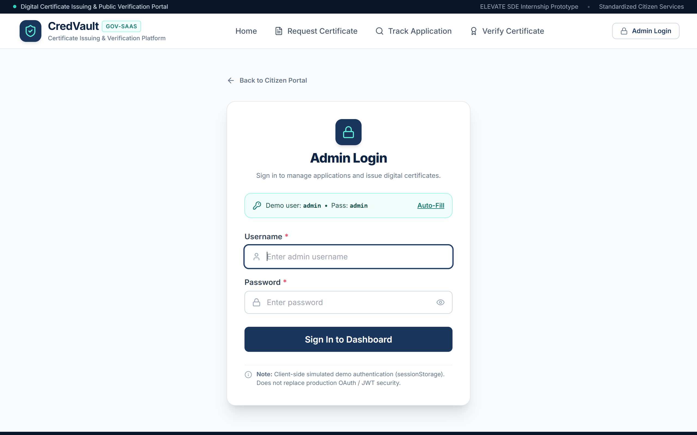
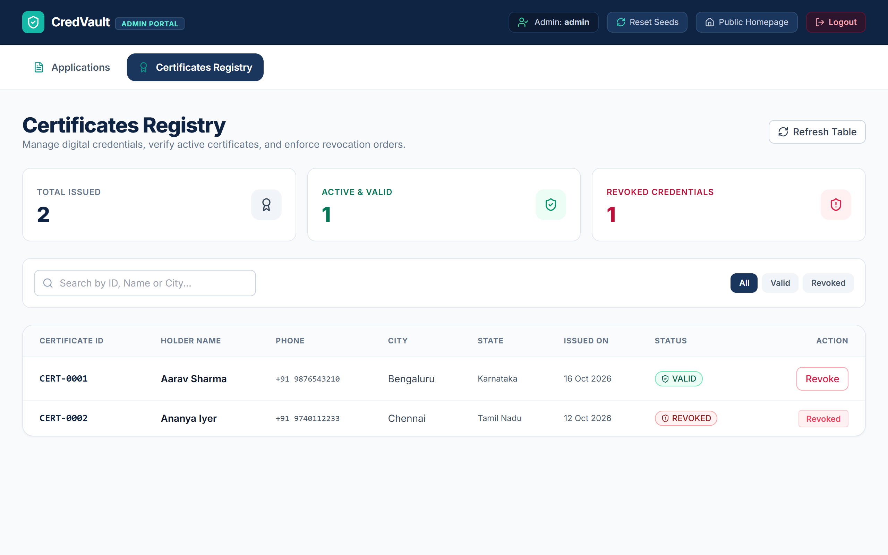

# CredVault – Certificate Issuing & Verification Platform

A modern, responsive frontend web application developed as part of **ELEVATE SDE Internship – Task 2 (Full Stack Development)**.

CredVault allows citizens to request certificates, track their applications, and verify issued certificates. Administrators can manage applications, issue certificates, reject applications, and revoke certificates through an admin dashboard.

## 🚀 Features

### 👤 Citizen Features
- **Home Page:** Simple navigation to all public services.
- **Request Certificate:** Submit certificate requests with personal details.
- **Track Application:** Check application status using an Application ID.
- **Verify Certificate:** Verify certificates using a Certificate ID.
- **Form Validation:** Required fields and mobile number validation.
- **Application ID Generation:** Automatically generates unique application IDs.
- **Status Tracking:** Displays Pending, Approved, and Rejected application statuses.

### 🔐 Admin Features
- **Admin Login:** Demo login for administrator access.
- **Application Management:** View and search submitted applications.
- **Issue Certificates:** Approve applications and generate unique Certificate IDs.
- **Reject Applications:** Reject pending certificate applications.
- **Certificate Management:** View all issued certificates.
- **Revoke Certificates:** Revoke previously issued certificates.
- **Dashboard Statistics:** View application and certificate counts.
- **Search and Filters:** Find records by ID, name, or status.

### 💾 Data Persistence
- Uses browser `localStorage` to store demo applications and certificates.
- Data remains available after refreshing the browser.
- Updates application and certificate statuses when admin actions are performed.
- Uses dummy data; no backend or database is required for this task.

## 🛠️ Technologies Used

- React.js
- Vite
- JavaScript
- Tailwind CSS
- React Router DOM
- Lucide React
- HTML5
- CSS3
- Browser localStorage

## 📄 Application Pages

| Page | Route | Description |
|---|---|---|
| Home | `/` | Main page with navigation to public services |
| Request Certificate | `/request` | Submit a certificate application |
| Track Application | `/track` | Track an application using its ID |
| Verify Certificate | `/verify` | Verify a certificate using its ID |
| Admin Login | `/admin/login` | Administrator demo login |
| Admin Applications | `/admin/applications` | View, issue, and reject applications |
| Admin Certificates | `/admin/certificates` | View and revoke issued certificates |

## 📸 Screenshots

The following screenshots demonstrate the main pages of the CredVault application.

### 1. Home Page


### 2. Request Certificate


### 3. Track Application


### 4. Verify Certificate


### 5. Admin Login


### 6. Admin Applications


### 7. Admin Certificates


> **Note:** Replace these screenshot paths with the actual filenames if your screenshots use different names. Upload the screenshot files to the `screenshots` folder in this repository so they display correctly.

## ⚙️ Installation and Setup

### Prerequisites
- Node.js and npm installed.
- Git installed (optional, for Git-based upload).
- A modern web browser such as Google Chrome.

### Step 1: Clone the Repository

```bash
git clone https://github.com/ashwinibn16-png/ELEVATE-SDE-Task-2.git
```

Replace `ashwinibn16-png` with your GitHub username.

### Step 2: Navigate to the Project Folder

```bash
cd ELEVATE-SDE-Task-2
```

### Step 3: Install Dependencies

```bash
npm install
```

### Step 4: Start the Development Server

```bash
npm run dev
```

### Step 5: Open the Application

Open the local URL displayed in your terminal. With a standard Vite configuration, it is usually:

```text
http://localhost:5173
```

## 🔑 Demo Admin Credentials

Use the following credentials to access the admin dashboard.

| Field | Value |
|---|---|
| Username | `admin` |
| Password | `admin` |

**Important:** These credentials are for demonstration purposes only. The frontend login is not secure production authentication.

## 🧪 Sample Demo Data

Use the following sample IDs to test the application. Actual IDs may differ depending on the data initialized by the application.

| Record | Sample ID |
|---|---|
| Application ID | `APP-0001` |
| Certificate ID | `CERT-0001` |

If the sample IDs are not available in your running application, submit a new application or check the seeded demo records.

## 🔄 Application Workflow

1. A citizen opens the Home Page.
2. The citizen submits a certificate request.
3. CredVault generates an Application ID and saves the application.
4. The citizen tracks the application using the generated ID.
5. The administrator logs in and reviews pending applications.
6. The administrator approves and issues a certificate or rejects the application.
7. Issued certificates receive a unique Certificate ID.
8. The public verifies the certificate using its ID.
9. The administrator can revoke an issued certificate.
10. The verification page reflects the latest certificate status.

## 📁 Project Structure

```text
ELEVATE-SDE-Task-2/
├── public/
├── screenshots/
│   ├── home.png
│   ├── request.png
│   ├── track.png
│   ├── verify.png
│   ├── admin-login.png
│   ├── admin-applications.png
│   └── admin-certificates.png
├── src/
│   ├── components/
│   ├── pages/
│   ├── services/
│   ├── data/
│   ├── App.jsx
│   ├── main.jsx
│   └── index.css
├── .gitignore
├── index.html
├── package.json
├── package-lock.json
└── README.md
```

*The exact folder structure may vary slightly depending on the implementation.*

## 🔒 Limitations

- This project is a frontend-only prototype.
- No backend API or database is connected.
- Demo records are stored in the browser's localStorage.
- Data is specific to the browser and device where it is stored.
- Client-side admin authentication is for demonstration only.
- Certificate verification uses local demo records and does not connect to a government registry.

## 🔮 Future Enhancements

- Integrate a secure backend API.
- Add a database for applications and certificates.
- Implement secure administrator authentication and role-based access.
- Add email or SMS notifications.
- Generate downloadable digital certificates in PDF format.
- Add QR-code-based certificate verification.
- Maintain an audit log for certificate issuance and revocation.
- Deploy the application to a hosting platform.

## 👩‍💻 Internship Information

- **Program:** ELEVATE Internship Program
- **Role:** Software Development Engineer Intern – Full Stack Development
- **Task:** Task 2 – Certificate Issuing & Verification Platform
- **Project:** CredVault

## 📜 Disclaimer

CredVault is an educational frontend prototype created for internship learning and demonstration. It is not an official government service, and its demo authentication and certificate records must not be used for real-world verification.

---

**Developed as part of the ELEVATE SDE Internship Program.**# CredVault – Certificate Issuing & Verification Platform

A modern, responsive frontend web application developed as part of **ELEVATE SDE Internship – Task 2 (Full Stack Development)**.

CredVault allows citizens to request certificates, track their applications, and verify issued certificates. Administrators can manage applications, issue certificates, reject applications, and revoke certificates through an admin dashboard.

## 🚀 Features

### 👤 Citizen Features
- **Home Page:** Simple navigation to all public services.
- **Request Certificate:** Submit certificate requests with personal details.
- **Track Application:** Check application status using an Application ID.
- **Verify Certificate:** Verify certificates using a Certificate ID.
- **Form Validation:** Required fields and mobile number validation.
- **Application ID Generation:** Automatically generates unique application IDs.
- **Status Tracking:** Displays Pending, Approved, and Rejected application statuses.

### 🔐 Admin Features
- **Admin Login:** Demo login for administrator access.
- **Application Management:** View and search submitted applications.
- **Issue Certificates:** Approve applications and generate unique Certificate IDs.
- **Reject Applications:** Reject pending certificate applications.
- **Certificate Management:** View all issued certificates.
- **Revoke Certificates:** Revoke previously issued certificates.
- **Dashboard Statistics:** View application and certificate counts.
- **Search and Filters:** Find records by ID, name, or status.

### 💾 Data Persistence
- Uses browser `localStorage` to store demo applications and certificates.
- Data remains available after refreshing the browser.
- Updates application and certificate statuses when admin actions are performed.
- Uses dummy data; no backend or database is required for this task.

## 🛠️ Technologies Used

- React.js
- Vite
- JavaScript
- Tailwind CSS
- React Router DOM
- Lucide React
- HTML5
- CSS3
- Browser localStorage

## 📄 Application Pages

| Page | Route | Description |
|---|---|---|
| Home | `/` | Main page with navigation to public services |
| Request Certificate | `/request` | Submit a certificate application |
| Track Application | `/track` | Track an application using its ID |
| Verify Certificate | `/verify` | Verify a certificate using its ID |
| Admin Login | `/admin/login` | Administrator demo login |
| Admin Applications | `/admin/applications` | View, issue, and reject applications |
| Admin Certificates | `/admin/certificates` | View and revoke issued certificates |

## 📸 Screenshots

The following screenshots demonstrate the main pages of the CredVault application.

### 1. Home Page
 


### 2. Request Certificate


### 3. Track Application


### 4. Verify Certificate


### 5. Admin Login


### 6. Admin Applications


### 7. Admin Certificates


> **Note:** Replace these screenshot paths with the actual filenames if your screenshots use different names. Upload the screenshot files to the `screenshots` folder in this repository so they display correctly.

## ⚙️ Installation and Setup

### Prerequisites
- Node.js and npm installed.
- Git installed (optional, for Git-based upload).
- A modern web browser such as Google Chrome.

### Step 1: Clone the Repository

```bash
git clone https://github.com/YOUR-USERNAME/ELEVATE-SDE-Task-2.git
```

Replace `YOUR-USERNAME` with your GitHub username.

### Step 2: Navigate to the Project Folder

```bash
cd ELEVATE-SDE-Task-2
```

### Step 3: Install Dependencies

```bash
npm install
```

### Step 4: Start the Development Server

```bash
npm run dev
```

### Step 5: Open the Application

Open the local URL displayed in your terminal. With a standard Vite configuration, it is usually:

```text
http://localhost:5173
```

## 🔑 Demo Admin Credentials

Use the following credentials to access the admin dashboard.

| Field | Value |
|---|---|
| Username | `admin` |
| Password | `admin` |

**Important:** These credentials are for demonstration purposes only. The frontend login is not secure production authentication.

## 🧪 Sample Demo Data

Use the following sample IDs to test the application. Actual IDs may differ depending on the data initialized by the application.

| Record | Sample ID |
|---|---|
| Application ID | `APP-0001` |
| Certificate ID | `CERT-0001` |

If the sample IDs are not available in your running application, submit a new application or check the seeded demo records.

## 🔄 Application Workflow

1. A citizen opens the Home Page.
2. The citizen submits a certificate request.
3. CredVault generates an Application ID and saves the application.
4. The citizen tracks the application using the generated ID.
5. The administrator logs in and reviews pending applications.
6. The administrator approves and issues a certificate or rejects the application.
7. Issued certificates receive a unique Certificate ID.
8. The public verifies the certificate using its ID.
9. The administrator can revoke an issued certificate.
10. The verification page reflects the latest certificate status.

## 📁 Project Structure

```text
ELEVATE-SDE-Task-2/
├── public/
├── screenshots/
│   ├── home.png
│   ├── request.png
│   ├── track.png
│   ├── verify.png
│   ├── admin-login.png
│   ├── admin-applications.png
│   └── admin-certificates.png
├── src/
│   ├── components/
│   ├── pages/
│   ├── services/
│   ├── data/
│   ├── App.jsx
│   ├── main.jsx
│   └── index.css
├── .gitignore
├── index.html
├── package.json
├── package-lock.json
└── README.md
```

*The exact folder structure may vary slightly depending on the implementation.*

## 🔒 Limitations

- This project is a frontend-only prototype.
- No backend API or database is connected.
- Demo records are stored in the browser's localStorage.
- Data is specific to the browser and device where it is stored.
- Client-side admin authentication is for demonstration only.
- Certificate verification uses local demo records and does not connect to a government registry.

## 🔮 Future Enhancements

- Integrate a secure backend API.
- Add a database for applications and certificates.
- Implement secure administrator authentication and role-based access.
- Add email or SMS notifications.
- Generate downloadable digital certificates in PDF format.
- Add QR-code-based certificate verification.
- Maintain an audit log for certificate issuance and revocation.
- Deploy the application to a hosting platform.

## 👩‍💻 Internship Information

- **Program:** ELEVATE Internship Program
- **Role:** Software Development Engineer Intern – Full Stack Development
- **Task:** Task 2 – Certificate Issuing & Verification Platform
- **Project:** CredVault

## 📜 Disclaimer

CredVault is an educational frontend prototype created for internship learning and demonstration. It is not an official government service, and its demo authentication and certificate records must not be used for real-world verification.

---

**Developed as part of the ELEVATE SDE Internship Program.**# ELEVATE-SDE-Task-2
CredVault – Certificate Issuing &amp; Verification Platform | ELEVATE SDE Internship Task 2
